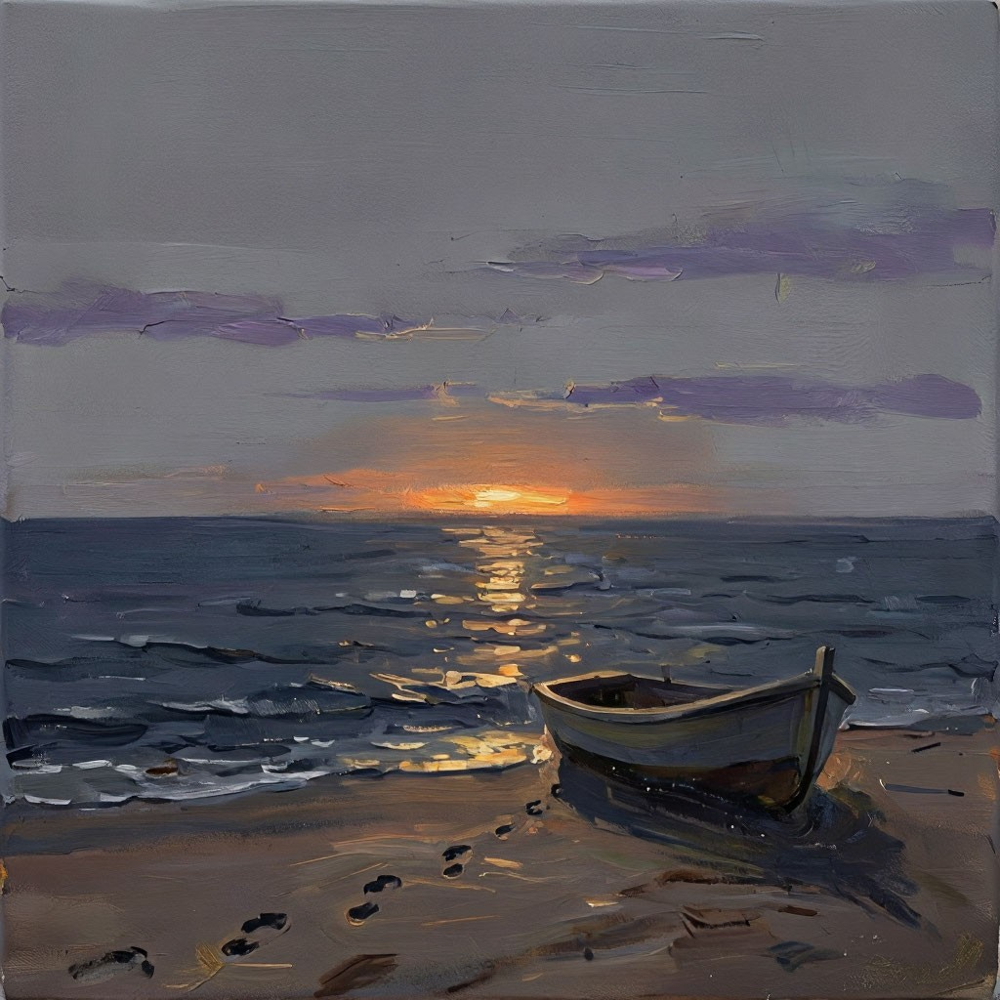
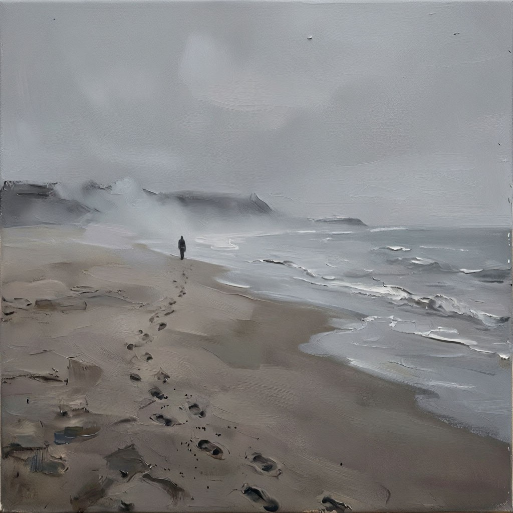
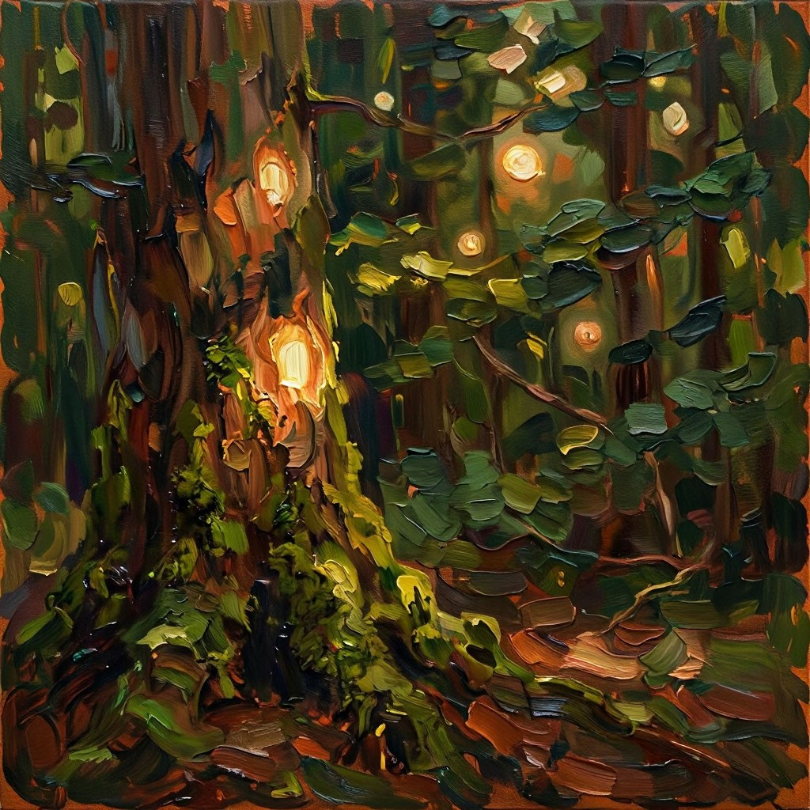
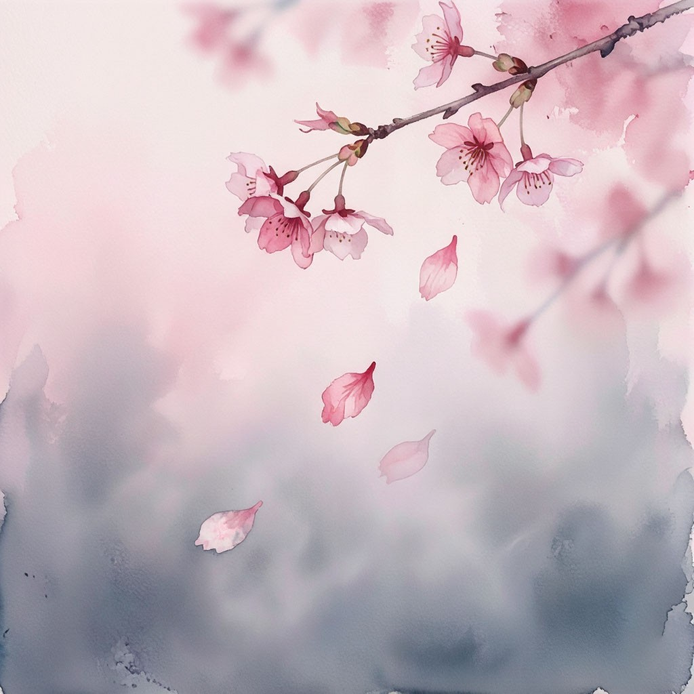

# Отчёт по работе "АХ: Агент-художник"

## Выполнили

* *(ФИО)* — идея, код, отчёт, сайт

## Мотивирующий абзац (Project Statement)

Мы рисуем не «картину на тему», а **непереводимые слова** — *тоска*, *komorebi*, *hiraeth*, *mono no aware*, *sobremesa* —
и проверяем, может ли многоагентная система перевести их на язык изображения так, чтобы смысл понял зритель,
который этого слова не знает. Для этого в контур обратной связи встроен **«слепой» VLM-критик**: он видит только
картину, без подписи и без замысла, и сам формулирует, о чём она. Отдельный агент-судья (он, наоборот, не видит
картину) сравнивает эту интерпретацию со значением слова и ставит балл 0–10. Получается игра в «Крокодил» между
нейросетями, а у качества появляется измеримый критерий — не «красиво ли», а **«дошёл ли смысл»**.

Что отличает работу от простейшей реализации:

* **Разделение ролей по информации.** Критик не знает слова, судья не видит картину — ни один агент не может
  «подыграть» сам себе, а обратная связь описывает именно разрыв между замыслом и восприятием.
* **Настоящий спор двух разных LLM.** Художник (Alice AI LLM) отвечает за метафору, промпт-инженер (DeepSeek V4.1 Flash)
  знает ограничения Alice AI ART и настроен спорить: упрощать, убирать то, что генератор не нарисует, ловить неочевидные образы.
* **Измеримая польза обратной связи.** Для каждого слова видно, как балл меняется от версии к версии, —
  можно честно ответить, помогает ли агентский контур.
* **Куратор и сайт-выставка.** Для лучшей версии куратор пишет музейную этикетку, а на сайте (GitHub Pages, `docs/`)
  можно переключать версии картин, видеть, что «понял» зритель, и читать весь диалог агентов.

## Использование ИИ

Код ноутбука, сайт и черновик отчёта написаны с помощью кодинг-агента **Claude Code** (модель Claude Opus 5.5).
Исходный запрос агенту был одной строкой: *«Нужно сделать эту лабораторную работу описанную в readme»*;
дальше агент уточнил объём работы (VLM-петля, сайт на GitHub Pages, концепция на его выбор) и предложил идею
«Непереводимого» со слепым критиком. Инструкции для агента по устройству проекта лежат в [AGENTS.md](AGENTS.md).

Агент же отлаживал реальный прогон: когда генератор начал отклонять промпты, он перебором промптов
нашёл слово-триггер модерации и добавил защиту в ноутбук. До этого логика пайплайна была проверена прогоном всего ноутбука на фейковом OpenAI-клиенте (имитировались отказ модерации,
слишком длинный промпт, ответ критика не в JSON, отказ Responses API принимать картинку), сайт — в браузере на тестовых данных,
включая мобильную ширину.

Сами картины, диалоги и оценки создаются моделями Yandex AI Studio во время запуска ноутбука:

| Роль | Модель |
|---|---|
| 🎨 Художник, 🏛 Куратор | `aliceai-llm` |
| 🛠 Промпт-инженер | `deepseek-v4.1-flash` |
| 👁 Слепой критик (VLM), ⚖️ Судья | `qwen3.6-35b-a3b` |
| 🖼 Генератор | `aliceai-image-art-3.0` |

## Результаты

Сайт с выставкой: https://denisamell.github.io/Agent_Artist/. На нём для каждого слова можно переключать версии,
смотреть, что «увидел» слепой критик, и читать весь диалог агентов.

Коллекция: 5 слов, 13 картин, около 15 минут работы. Баллы судьи (насколько слепой зритель понял смысл):

| Слово | Название (куратор) | Баллы по версиям | Лучшая |
|---|---|---|---|
| Тоска (рус.) | «На грани размышлений» | 4 → 4 → **7** | v3 |
| Komorebi (яп.) | «Лесное утро» | 2 → **7** → 7 | v3 |
| Hiraeth (валл.) | «Перевёрнутый дом» | 4 → **5** → 3 | v2 |
| Mono no aware (яп.) | «Мимолётность сакуры» | **9** | v1 |
| Sobremesa (исп.) | «После трапезы» | 6 → **7** → 4 | v2 |

**Средний балл первой версии — 5.0, лучшей — 7.0.** Петля обратной связи с VLM в среднем добавила 2 балла.

| Тоска, v1 → v3 | Komorebi, v1 → v3 | Mono no aware |
|---|---|---|
|   |   |  |
| Закат с лодкой зритель прочёл как «умиротворение» (4/10). Свинцовый берег с крошечной фигурой — уже «тихая меланхолия, время замирает» (7/10) | Первая версия: зритель увидел «ночное таинство и магию леса» (2/10). Инженер разобрал причину: «тёмная чаща плюс светлые пятна — мозг достраивает ночь» | Сакура и падающие лепестки — с первой попытки: «мимолётность бытия, весенняя меланхолия» (9/10) |

### Фрагменты, которыми мы гордимся

**Инженер спорит, а не соглашается** (komorebi, версия 1):

> 🛠 «Пульсирующий свет» и «мимолётность» — абстракции, генератор их не нарисует: получится просто лес. […]
> Предлагаю якорь: на переднем плане мшистый камень или ствол, на который падает одно ясное золотое пятно.

**Разбор провала по отзыву слепого критика** (komorebi, версия 2, после оценки 2/10):

> 🛠 Главная причина провала: тёмная чаща плюс светлые пятна — мозг достраивает ночь. Значит, вся сцена должна быть
> светлой и тёплой […] Пятна не должны быть круглыми: сделай их косыми, вытянутыми, падающими под углом.

Следующая версия получила 7/10.

**Агенты сами справляются со сбоем** (тоска, версия 2). Художник на Alice AI LLM вдруг ответил: *«Я не могу обсуждать
эту тему. Давайте поговорим о чём-нибудь ещё»*. Видимо, сработал фильтр на тему тоски и безнадёжности. Инженер на
DeepSeek не растерялся:

> 🛠 Странно — в идее нет ничего запретного: берег, лодка, силуэт, небо. Возможно, сработала случайная фильтрация.
> Давай просто продолжим. […] Вопрос: оставляем лодку или убираем её ради чистого фокуса на силуэте и жёлтой полосе?

После этого художник вернулся в диалог.

## Выводы

* **Слепой критик — главное, что сделало работу интересной.** Он ловит то, что авторы не замечают: «тёмный лес со
  светлыми пятнами» читается как ночь, закат с лодкой — как покой, а не тоска. Будь у критика подсказка, что рисовали,
  он нашёл бы тоску в любой картине.
* **Обратная связь помогает, но не монотонно.** Средний балл вырос с 5.0 до 7.0, но у *hiraeth* и *sobremesa* третья
  версия оказалась хуже второй: агенты «перекрутили» образ, исправляя одно и теряя другое. Поэтому лучшую версию нужно
  выбирать по баллу, а не брать последнюю.
* **Абстрактное труднее визуального, но не всегда.** *Mono no aware* попало с первой попытки, потому что у него есть готовый
  культурный образ — сакура. А *hiraeth* (тоска по дому, которого, может, и не было) так и не поднялась выше 5/10:
  зритель упорно видел в тёплом окне «надежду и уют», а не горе.
* **Модерация реагирует на слова, а не на смысл.** Первый запуск упал: Alice AI ART отклоняла все промпты к «тоске».
  Перебором вариантов мы выяснили, что виновато слово «голые» в «голые ветви», а «безлистные ветви» проходят.
  Отсюда фильтр рискованных слов в коде и подсказка инженеру. Отдельно отказала и текстовая модель-художник,
  а вторая LLM в диалоге вытащила разговор — ещё один довод за разные модели в разных ролях.
* **Разные модели дают настоящий спор.** DeepSeek в роли инженера стабильно находил слабые места («руки — его слабое
  место», «запреты он понимает плохо»), а Alice AI LLM в роли художника охотно перестраивала образ. Диалог читается как
  живая работа над картиной, а не как эхо.
* **LLM нужно страховать кодом.** JSON вытаскивается регулярками с переспросом, промпт обрезается по лимиту в 500 символов,
  отказы генератора переписываются, а результаты сохраняются после каждого слова. Без этого длинный многоагентный прогон
  обязательно падает на середине.
